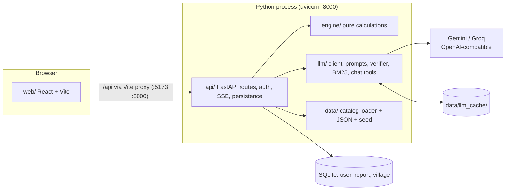
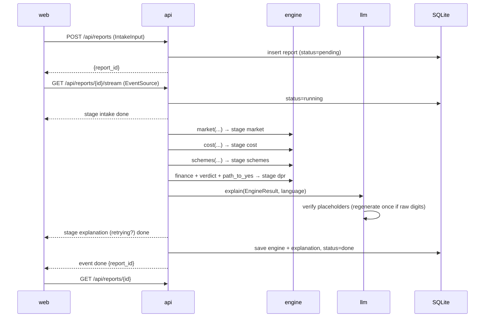
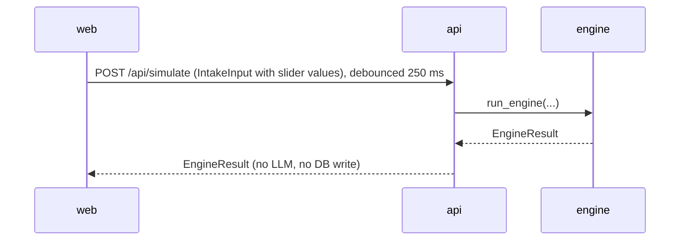
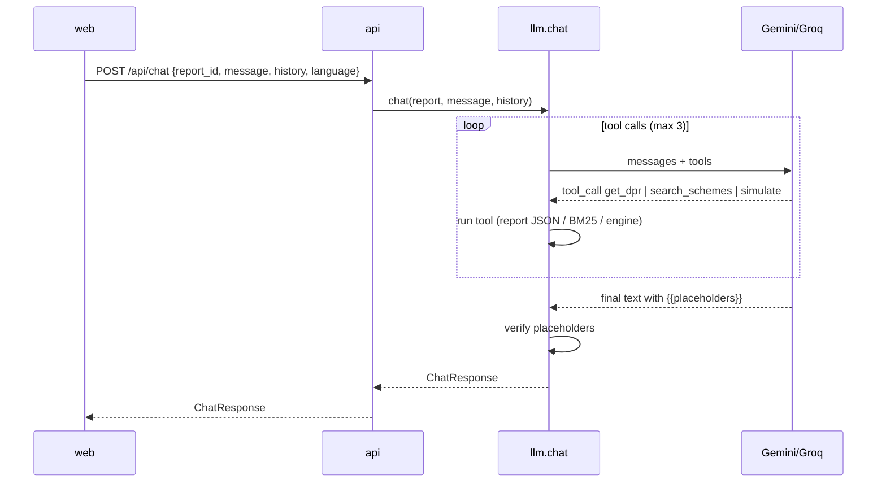

# Architecture

How the system is put together. **What** it does is in [`prd.md`](prd.md), **technical rules and algorithms** are in [`trd.md`](trd.md), and **every endpoint and model** is in [`api-contracts.md`](api-contracts.md). Vocabulary: [`CONTEXT.md`](../CONTEXT.md).

## 1. Shape in one picture



Two processes run locally: `npm run dev` (Vite on :5173) and `uv run uvicorn api.main:app --reload` (on :8000). Vite proxies `/api/*` to :8000, so the browser sees one origin: cookies work and there's no CORS.

## 2. Components and dependency rules

| Component | Owner | Responsibility | May import |
|---|---|---|---|
| `api/` | Fullstack | HTTP routes, session auth, SSE pipeline driver, DB models and persistence, `contracts.py` (all Pydantic models) | `engine`, `llm`, `data` |
| `engine/` | AIML | Pure functions: cost, market, scheme matching, finance, Verdict, Path to Yes | `api.contracts` only (Pydantic models, no I/O) |
| `llm/` | AIML | LLM client with fallback and cache, prompts, Entrepreneur View generation, placeholder verifier, intake parser, BM25 retrieval, chat tools, eval script | `api.contracts`, `engine` (chat's `simulate` tool) |
| `data/` | AIML | `archetypes.json`, `schemes.json`, `scheme_texts/`, Census/OSM source files, `catalog.py` (loads JSON), `seed.py` (fills the `village` table) | `api.contracts` |
| `web/` | Frontend | All pages, charts, i18n, number formatting, print stylesheet. `src/types/contracts.ts` is **generated**, never hand-edited | — |

**Rules that keep merges painless**
- `engine/` never imports `api` routes, `llm`, `data`, the DB, or anything doing network or file I/O. The caller passes catalogue data in as arguments.
- Only `api/` touches the DB.
- Only `llm/` talks to LLM providers.
- `contracts.py` is the single source of truth for every shape. `contracts.ts` is regenerated from OpenAPI.

## 3. Folder tree

```
/
├── pyproject.toml          # one uv project: api, engine, llm, data
├── uv.lock
├── .python-version         # 3.12
├── .env.example
├── CLAUDE.md  CONTEXT.md
├── api/
│   ├── main.py             # app, SessionMiddleware, router includes
│   ├── contracts.py        # ALL Pydantic request/response models
│   ├── db.py               # engine, SQLModel tables, get_session
│   ├── auth.py             # scrypt hashing, current_user dependency
│   ├── pipeline.py         # runs stages, yields StageEvents
│   └── routes/
│       ├── auth.py  catalog.py  intake.py  reports.py
│       ├── simulate.py  compare.py  chat.py  voice.py
├── engine/
│   ├── __init__.py         # run_engine(input, archetype, schemes, village) -> EngineResult
│   ├── cost.py  market.py  schemes.py  finance.py
│   ├── verdict.py  path_to_yes.py  figures.py
├── llm/
│   ├── client.py           # OpenAI SDK, provider switch, fallback
│   ├── cache.py            # live / record / replay
│   ├── prompts/            # *.md prompt templates
│   ├── explain.py          # Entrepreneur View + Comparison paragraph
│   ├── verifier.py         # placeholder check
│   ├── intake.py           # free text -> IntakeInput fields
│   ├── retrieval.py        # BM25 over scheme_texts
│   ├── chat.py             # tool-calling loop
│   └── eval.py             # 15-case eval
├── data/
│   ├── catalog.py          # load_archetypes(), load_schemes()
│   ├── seed.py             # Census + LGD + OSM -> village table
│   ├── archetypes.json  schemes.json
│   ├── scheme_texts/       # official text per scheme, for citations
│   ├── census/  osm/       # raw source files for Niphad
│   └── llm_cache/          # recorded LLM responses (committed)
├── fixtures/
│   └── report.json         # contract-shaped sample, used by web/ in V1–V2
├── tests/
│   ├── engine/             # pytest, one file per engine module
│   └── test_api_smoke.py
└── web/
    ├── vite.config.ts      # proxy /api -> :8000
    └── src/
        ├── main.tsx  routes.tsx  api.ts
        ├── types/contracts.ts      # GENERATED
        ├── i18n/  en.json hi.json mr.json  index.tsx
        ├── lib/format.ts           # Intl.NumberFormat per language
        ├── components/             # shadcn/ui + shared (FigureChip, SourceBadge, StageTrace)
        └── pages/  Home Login New Report Compare MyReports
```

## 4. Flows

### 4.1 Build a DPR (report pipeline)



The pipeline runs **inside the stream handler**. There's no background job system. If the stream is opened again for a report that is already `done`, the handler replays the stored stages instantly and sends `done`.

### 4.2 What-if simulator



The page diffs the new result against the saved one to highlight a Scheme or Verdict flip.

### 4.3 Comparison

`POST /api/compare` runs `run_engine` once per Archetype (each at its default unit scale), then calls `llm.explain` once for the short summary paragraph, and returns a `Comparison`. Nothing is saved.

### 4.4 Chat advisor



Chat never writes to the DB. `simulate` results come back as `suggested_changes` for the Entrepreneur to apply with the sliders.

## 5. Data at rest

| Store | Holds | Written by |
|---|---|---|
| `data/*.json` | Archetypes, Schemes (hand-curated, in git) | AIML, by hand |
| SQLite `village` | Niphad villages: LGD codes, Census counts, OSM competitor counts per Archetype | `data/seed.py`, once |
| SQLite `user` | Username + scrypt hash | `/api/auth/register` |
| SQLite `report` | Input, engine output, explanation (JSON columns), status, owner | Report pipeline |
| `data/llm_cache/` | Recorded LLM responses keyed by hash | `llm/cache.py` in `record` mode |

`DATABASE_URL` defaults to `sqlite:///./requiem.db`. Pointing it at Neon Postgres works without code changes because SQLModel's JSON columns map to `JSONB` there. This is checked once in V3.

## 6. Failure handling

| Failure | Behaviour |
|---|---|
| Primary LLM errors or times out (15 s) | `llm.client` retries once on the fallback provider |
| Both providers fail | `replay` from cache if the hash exists; otherwise the `explanation` stage fails, the report is still saved with the engine result, and the Entrepreneur View shows "explanation unavailable, numbers below are complete" |
| LLM output has digits outside placeholders | Regenerate once (stage status `retrying`); if it still fails, remove the offending sentence and set `verified < total` |
| Unknown placeholder id | Same as above |
| Wifi down | Run with `LLM_MODE=replay`; everything else is local |
| Village has no OSM data | Competitors = 0 with `competitor_coverage = "low"`; the UI asks for an override |

## 7. Deployment

Localhost only. Demo laptop checklist:

1. `uv sync`
2. `uv run python -m data.seed`
3. `cd web && npm install`
4. Start both processes
5. Set `LLM_MODE=replay` as a fallback

Neon is wired for the switch only. No public deploy.
